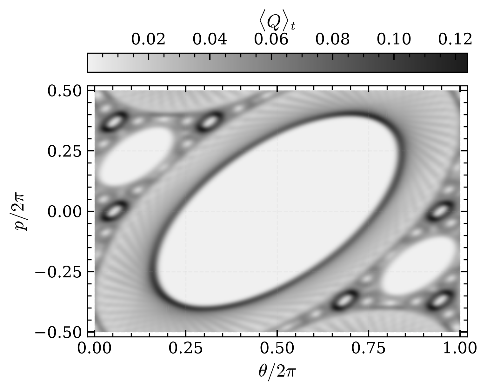
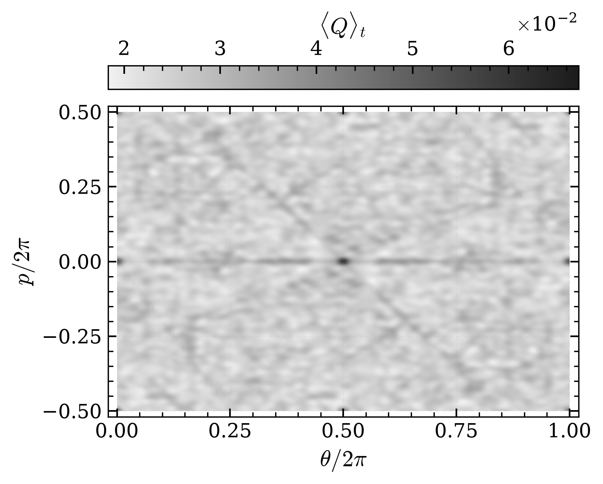
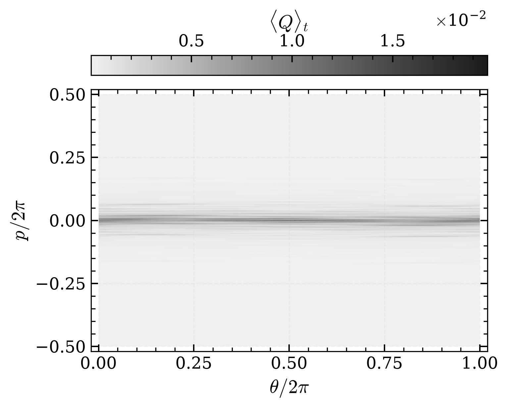

# Simulation of the Quantum Sawtooth Map


Code for the simulation of the Quantum Sawtooth Map (QSM). 
The Hamiltonian for the system is:
```math
\hat{H} = \frac{\hat{n}^2}{2} - \frac{k}{2}(\hat{\theta} - \pi)^2 \sum_{j=-\infty}^{+\infty}\delta(\tau - jT)
```
where $\hat{\theta}, \hat{n}$ are the conjugated operator. The wavefunction of the system is periodic in $\theta$: $\psi(\theta + 2 \pi) = \psi(\theta)$. The eigenvalues of $\hat{n}$ can be rescaled using the period $T$ as $p = T n$, and $p$ is taken periodic on $[-\pi L , \pi L)$ with $L \in \mathbb{N}$. For this choice the phase space for the system is a torus of side $2\pi L$. 
Choosing the number of qubits, $n_q$ for the quantum register, the Hilbert space has dimension $N = 2^{n_q}$.   
The period $T = \frac{2 \pi L}{N}$ is also the effective Planck constant for the system; in the limit $N \to \infty$ and $L=1$, the system approaches the classical behavior. 

The parameter $K = k T$ controls the regime of the system.
For $-4 < K < 0$ the behavior of the map is stable. In the semiclassical limit $N \to \infty$ the comportment of the quantum map approaches the classical version.
Instead, for $ K < -4$ and $K > 0$ the map has a chaotic behavior. A peculiar phenomenon of the quantistic version is the Dynamical Localization of the wavefunction in the momentum basis. 

Instead of using the quantum algorithm for the simulation, it's used the classical version. Given that the evolution operators are diagonal on the respective basis, the classical algorithm utilizes the Fast Fourier Transform (FFT) for the basis change. 

All these behaviors can be visualized with the Husimi Q function, that gives the quasi-probability distribution of the system wavefunction in angle-momentum phase space.

## Examples

For $n_q = 10$ and $K = -\sqrt{2}$, the map is in its stable regime. The initial wavefunction is peaked at momentum $n_0 = 409$ the quasi-probability in the angle-momentum phase space is similar to classical map. 

<p align="center">
    <br>
</p>

For $K = \sqrt{2}$, the map is chaotic. The presence of the dynamical localization depends on the parameter $L$. 
In the semiclassical limit, the behavior is fully chaotic; instead for $L \gg 1$ dynamical locatization can be observed. 

Starting from $n_0 = 0$, the wafunction goes from completely delocalized (on the left $L=1$) to a localizate wavefunction around the zero momentum (on the right $L=67$).

<p align="center">
  
  
</p>


## File Contents

[`Quantum_SM.ipynb`](Quantum_SM.ipynb) and [`Quantum_SM.py`](Quantum_SM.py) contain the code for dataset generation.

[`Husimi_dst.ipynb`](Husimi_dst.ipynb) generates the dataset used by `Husimi_visual` and stores it in the [`Data`](Data/) folder.

[`Husimi_visual.ipynb`](Husimi_visual.ipynb) visualizes the Husimi function and saves the figure in the [`Img`](Img/) folder.


## Usefull Lectures